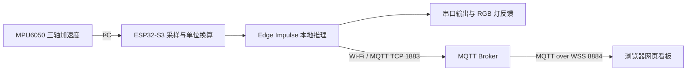

# ESP32-S3 TinyML 手势识别与 MQTT 网页看板

基于 **ESP32-S3、MPU6050 和 Edge Impulse** 的手势识别原型项目，已跑通从传感器采集、设备端模型推理，到 Wi-Fi / MQTT 上报和网页实时展示的完整链路。

当前支持识别 `idle`（静止）、`wave`（挥动）和 `shake`（抖动）三种状态。模型在 ESP32-S3 本地运行，联网用于传输识别结果；网页通过 MQTT over WebSocket 订阅消息并显示结果。

本项目是在开源示例和教程基础上进行硬件适配、功能整合与验证的学习实践，参考来源见文末“参考与致谢”。目前重点是验证端到端流程，持续采样、网络可靠性和完整训练资料仍有待完善。

## 已实现功能

| 环节 | 当前实现 |
| --- | --- |
| 传感器采集 | 通过 I²C 读取 MPU6050 三轴加速度，并换算为 m/s² |
| 设备端推理 | 调用 Edge Impulse 导出的模型库，输出三类状态及其置信度 |
| 本地反馈 | 串口打印识别结果、DSP 与推理耗时；板载 RGB 灯随类别变色 |
| 联网上报 | 经 2.4 GHz Wi-Fi 连接 MQTT Broker，发布 JSON 格式的推理结果 |
| 网页看板 | 显示当前类别、三类置信度、原始 JSON 和最近 30 条记录 |
| 看板辅助功能 | 提供本地模拟按钮、消息复制、记录清空及超过约 6 秒无新消息的提示 |

## 系统结构



设备与网页通过 **同一个 Broker、同一个 Topic** 对接，不要求处于同一局域网。网页展示的是设备已经计算好的识别结果。

## 硬件与接线

当前固件按 ESP32-S3 开发板配置，`platformio.ini` 使用 `esp32-s3-devkitc-1` 板型，并针对 **N16R8（16 MB Flash / 8 MB OPI PSRAM）** 覆盖了存储参数。烧录前应核对实际模块型号；其他 ESP32-S3 板卡需要相应调整配置、引脚和 RGB 灯驱动。

所需硬件：ESP32-S3 开发板、MPU6050 模块、USB 数据线和连接导线；联网上报还需要可用的 2.4 GHz Wi-Fi。

| MPU6050 | ESP32-S3 | 说明 |
| --- | --- | --- |
| VCC | 3.3V | 按所用模块供电要求连接，并保持 I²C 电平兼容 |
| GND | GND | 共地 |
| SDA | GPIO8 | 对应 `MPU6050_SDA` |
| SCL | GPIO9 | 对应 `MPU6050_SCL` |

程序使用 MPU6050 默认地址 `0x68`。板载 WS2812 RGB 灯配置为 GPIO48，识别状态与灯色对应如下：

| 类别 | 含义 | RGB 灯色 |
| --- | --- | --- |
| `idle` | 静止 | 绿色 |
| `wave` | 挥动 | 蓝色 |
| `shake` | 抖动 | 红色 |

固件中的加速度计和陀螺仪偏移量来自当前传感器的校准结果。更换模块后应重新校准，参考 [校准程序](<备份/calibration 备份.ino>)，并更新 `src/main.ino` 中的 `ACCEL_*_OFFSET` / `GYRO_*_OFFSET`。

## 软件环境

- 开发工具：[Cursor](https://cursor.com/) + [PlatformIO](https://platformio.org/)，日常编译、烧录和串口监视均在 Cursor 中完成。
- 开发框架：Arduino；PlatformIO 平台固定为 `espressif32 @ 8.0.0`。
- 本地库：`I2Cdev`、`MPU6050`、`ESP32-S3-TinyML_inferencing`，已放在 `lib/`。
- MQTT 库：`knolleary/PubSubClient@^2.8`，由 PlatformIO 按配置安装。
- 网页依赖：通过 jsDelivr CDN 加载 MQTT.js，无需 npm 构建或单独的应用后端。

Cursor 使用项目内 `.vscode/tasks.json` 定义的任务调用 PlatformIO。当前 `.vscode/` 配置包含原开发电脑的 PlatformIO 绝对路径，换电脑时需要调整，也可以使用下方的命令行方式。

## 快速开始

### 1. 配置设备

在 Cursor 文件面板中，将 [include/secrets.example.h](include/secrets.example.h) 复制为同目录下的 `secrets.h`，然后在 `include/secrets.h` 中填写自己的 Wi-Fi 名称和密码：

```cpp
#pragma once

#define WIFI_SSID "YOUR_WIFI_SSID"
#define WIFI_PASSWORD "YOUR_WIFI_PASSWORD"
```

`src/main.ino` 通过 `#include "secrets.h"` 读取配置，PlatformIO 会自动搜索项目的 `include/` 目录，无需修改编译参数。换电脑或首次克隆仓库后，需要先创建这份本地配置，再编译。

| 文件 | 用途 | 是否提交 Git |
| --- | --- | --- |
| `include/secrets.h` | 本机真实 Wi-Fi 名称和密码 | 否，已在 `.gitignore` 中排除 |
| `include/secrets.example.h` | 不含真实凭据的配置模板 | 是 |

更换 Wi-Fi 时，只需修改本机 `include/secrets.h`，再正常编译烧录。不要把真实信息填入示例文件，也不要使用 `git add -f` 强行添加本地配置。`.gitignore` 只影响 Git 文件跟踪；手动上传文件、打包分享时仍需排除 `secrets.h` 和含凭据的固件产物。

MQTT 参数仍在 `src/main.ino` 中设置：

```cpp
const char *mqtt_server = "broker.hivemq.com";
const uint16_t mqtt_port = 1883;
const char *mqtt_topic = "esp32s3-tinyml/YOUR_DEVICE/gesture";
```

ESP32-S3 使用 **2.4 GHz Wi-Fi**。当前源码和网页的默认 Topic 均为 `esp32s3-tinyml/aio/gesture`；建议换成自己的唯一主题，并同步修改网页中的 Topic，以免与其他测试设备串流。

### 2. 编译、烧录与查看串口

在 Cursor 中打开项目根目录，通过 `Ctrl+Shift+P` → `Tasks: Run Task`（任务：运行任务）选择：

- `ESP32: Build`：编译固件；也可以按 `Ctrl+Shift+B` 运行默认编译任务。
- `ESP32: List Ports`：查看当前串口。
- `ESP32: Upload`：选择烧录任务，按提示输入实际串口，例如 `COM7`。
- `ESP32: Serial Monitor`：按提示输入串口，以 115200 波特率查看输出。

也可以在 Cursor 的集成终端中运行以下等效命令：

```bash
# 编译固件
pio run -e esp32s3

# 查看可用串口
pio device list

# 烧录；COM7 仅为示例，请替换为实际串口
pio run -e esp32s3 -t upload --upload-port COM7

# 打开串口监视器
pio device monitor -p COM7 -b 115200
```

为避开 Windows 链接器的中文路径问题，当前 `build_dir` 设为 `../.pio-build/onboard-led-blink`。这是历史沿用的输出目录名，构建产物会生成在项目目录的上一级。

启动后，程序先检测 MPU6050，再尝试连接 Wi-Fi。Wi-Fi 启动连接最多等待约 20 秒，失败后仍进入本地识别流程；MQTT 未连接时跳过本次上报。

### 3. 打开网页看板

使用浏览器打开根目录的 [index.html](index.html)，填写连接参数后点击“连接”：

| 配置项 | 默认值 |
| --- | --- |
| 协议 | `wss` |
| Broker | `broker.hivemq.com` |
| 端口 | `8884` |
| Topic | `esp32s3-tinyml/aio/gesture`，需与设备一致 |

网页实际连接地址为 `wss://broker.hivemq.com:8884/mqtt`。设备使用的 `1883` 是原生 MQTT TCP 端口，网页使用的 `8884` 是 WebSocket TLS 端口，两者连接同一个 Broker，端口不需要填成一样。

也可以在项目根目录启动静态文件服务后访问网页，例如在已安装 Python 的电脑上执行：

```bash
python -m http.server 8000 --bind 127.0.0.1
```

然后打开 `http://127.0.0.1:8000/`。这里的 `8000` 是本地网页服务端口，与 MQTT Broker 端口无关。

暂时没有连接硬件时，可点击看板中的 `idle` / `wave` / `shake` 模拟按钮预览展示效果。模拟数据只在当前页面内生成，不会发布到 MQTT，也不能用于证明设备链路正常。连接 Broker 需要可用网络；若 MQTT.js 的 CDN 无法访问，也会影响网页连接功能。

### 4. 验证端到端流程

1. 串口确认 MPU6050、Wi-Fi 和 MQTT 的连接状态。
2. 保持传感器静止一个完整采样窗口，观察 `idle`、绿色灯和网页记录。
3. 连续挥动或抖动传感器，观察 `wave` / `shake`、对应灯色和置信度变化。
4. 对照串口“已上报”的 JSON 与网页原始消息，确认接收的是设备实际输出。

如网页没有收到数据，先检查设备是否确实上报、两端 Topic 是否一致，再检查浏览器到 Broker 的 WebSocket 连接、代理及防火墙设置。看板断流提示只说明一段时间没有新消息，不能单独判断设备是否断电。

## 采样与模型

以下参数来自当前固件及导出模型的元数据：

| 参数 | 当前值 |
| --- | --- |
| 输入通道 | `ax`、`ay`、`az` 三轴加速度 |
| 输入单位 | m/s² |
| 加速度计量程 | ±4g，换算灵敏度为 8192 LSB/g |
| 目标采样率 | 50 Hz，主循环按 20 ms 间隔读取 |
| 单窗口输入 | 99 个采样点 × 3 轴 = 297 个数值 |
| 窗口时长 | 约 2 秒 |
| DSP | Spectral Analysis（频谱特征提取） |
| 模型 | Edge Impulse 导出的编译模型，INT8 输入 / 输出 |
| 模型类别顺序 | `idle`、`shake`、`wave` |
| 输出策略 | 每个窗口取置信度最高的类别 |

固件当前使用顺序采样、攒满窗口后推理的方式，更新间隔还会受推理和网络调用耗时影响。当前没有对低置信度结果设置“未知手势”分支，因此三类之外的动作也可能被归入其中一类。

替换模型时，需要同步核对采样率、输入轴、单位、窗口大小、标签顺序，以及 `run_inference()` 中 JSON 字段与类别的映射。

目录保留了 [采集程序备份](备份/采集数据备份.ino) 和 `model/` 下的模型导出压缩包。采集备份采用早期的采样间隔公式，重新采集训练数据前应与模型要求的 20 ms 间隔对齐。当前仓库尚未提供原始训练数据、完整训练记录或标准测试集评估报告。

## MQTT 消息格式

默认发布主题：`esp32s3-tinyml/aio/gesture`。

```json
{
  "label": "wave",
  "confidence": 0.98,
  "idle": 0.00,
  "shake": 0.02,
  "wave": 0.98
}
```

| 字段 | 含义 |
| --- | --- |
| `label` | 当前置信度最高的类别 |
| `confidence` | 该类别的置信度，范围 0～1 |
| `idle` / `shake` / `wave` | 各类别的置信度，按两位小数上报 |

当前消息不包含设备时间戳或设备标识；看板记录的时间为**浏览器接收时间**。发布使用 QoS 0、非保留消息，设备离线或发布失败时没有消息缓存与补发。

## 目录结构

```text
.
├── README.md                         # 项目介绍与运行说明
├── platformio.ini                    # 固件构建配置与依赖
├── include/
│   ├── secrets.example.h             # 可提交的 Wi-Fi 配置模板
│   └── secrets.h                     # 本机 Wi-Fi 凭据，Git 忽略，需自行创建
├── src/
│   └── main.ino                      # 采样、推理、灯光反馈与 MQTT 上报
├── lib/
│   ├── I2Cdev/                       # I²C 设备访问库
│   ├── MPU6050/                      # MPU6050 驱动
│   └── ESP32-S3-TinyML_inferencing/   # Edge Impulse 模型与推理 SDK
├── index.html                        # MQTT 网页看板
├── model/                            # 模型导出压缩包
├── doc/                              # 学习与联网验证记录
├── 备份/                             # 采集、校准程序及 esp-dsp 备份
└── XIAO-ESP32S3-Sense/                # 本机上游参考仓库，Git 忽略，不随本项目上传
```

PlatformIO 的固件入口是 `src/main.ino`。`备份/` 和本机 `XIAO-ESP32S3-Sense/` 中的其他示例不参与当前主程序构建。后者是独立的上游参考仓库，已加入 `.gitignore`，需要查阅时可通过“参考与致谢”中的链接单独获取。联网实践记录见 [Wi-Fi + MQTT 学习记录](doc/2026-11-12-day4-wifi-mqtt.md)，其中部分 `tutorial/` 路径属于早期工作区，当前目录未包含这些文件。

## 当前限制与后续方向

- **采样时序**：采样、推理和 MQTT 维护共用主循环。MQTT 每约 5 秒尝试重连，但 `mqtt.connect()` 本身仍是同步调用，网络异常可能延迟采样；后续可通过独立任务或缓冲机制改善。
- **断线恢复**：启动时有 Wi-Fi 连接超时处理；尚未实现完整的 Wi-Fi 重连状态机、离线缓存与补发。网页关闭了自动重连，连接断开后需手动连接。
- **模型评估**：目前以三类动作的链路验证为主，尚缺少跨用户、不同安装方向及复杂动作的系统评估。
- **部署条件**：当前使用无鉴权的公共测试 Broker，设备端为明文 MQTT；适合学习演示。后续可配置自建 Broker、身份认证和设备端 TLS。
- **数据保存**：看板仅保留当前页面内最近 30 条消息，刷新后清空，尚无数据库或历史查询服务。
- **训练复现**：后续补充数据集说明、采集规范、训练配置及评估结果。

## 参考与致谢

本项目的实现参考了已有开源项目与工具，当前整合工作包括：将采集与推理流程适配到本项目的 ESP32-S3 接线和构建配置，接入 MQTT 结果上报，并配套网页看板完成链路验证。

| 来源 | 本项目中的用途或参考范围 |
| --- | --- |
| [Mjrovai / XIAO-ESP32S3-Sense](https://github.com/Mjrovai/XIAO-ESP32S3-Sense) | 核心 TinyML 流程参考：MPU6050 数据采集、校准、模型训练与部署推理；本地保留相关资料与示例 |
| [Nilina2002 / Smart-Helmet-using-ESP32](https://github.com/Nilina2002/Smart-Helmet-using-ESP32) | 联网部分参考：Wi-Fi / MQTT 结果上报与网页看板思路；在本项目中与手势识别流程整合 |
| [Jeff Rowberg / i2cdevlib](https://github.com/jrowberg/i2cdevlib) | 本地 `I2Cdev` 与 `MPU6050` 驱动；采集和校准示例亦保留了原作者声明 |
| [Edge Impulse](https://www.edgeimpulse.com/) | 模型导出、DSP 与设备端推理工具链 |
| [PubSubClient](https://github.com/knolleary/pubsubclient) | Arduino MQTT 客户端 |
| [MQTT.js](https://github.com/mqttjs/MQTT.js) | 网页 MQTT over WebSocket 客户端 |

## 许可证与发布说明

当前根目录尚未为本项目新增部分指定统一许可证。第三方代码、示例、模型和资料保留各自的版权与许可要求；“参考与致谢”不能替代许可证要求的声明。

- XIAO-ESP32S3-Sense 上游附有 [Apache-2.0 许可证](https://github.com/Mjrovai/XIAO-ESP32S3-Sense/blob/main/LICENSE)，具体文件如有单独声明，应同时遵守。
- 本地 `I2Cdev` / `MPU6050` 源文件头包含 MIT 许可声明，应随相关代码保留。
- Edge Impulse SDK 的许可说明见 [SDK LICENSE](lib/ESP32-S3-TinyML_inferencing/src/edge-impulse-sdk/LICENSE)，其中也列出了第三方组件的不同许可证。
- **模型导出包需单独核对授权**：当前 [model_metadata.h](lib/ESP32-S3-TinyML_inferencing/src/model-parameters/model_metadata.h) 等生成文件的文件头声明适用 Edge Impulse 服务条款，并包含“requires an active paid Edge Impulse subscription”的要求。公开分发 `lib/ESP32-S3-TinyML_inferencing/` 和 `model/` 中的导出包前，应结合实际账户、导出方式及对应条款确认使用与分发权限，不能仅以 SDK 的通用许可证认定整个导出包的授权。

真实 Wi-Fi 凭据仅保存在 Git 忽略的 `include/secrets.h` 中。如果凭据曾经提交或推送过，仅添加忽略规则不能删除历史记录，应先更换密码并处理已跟踪文件及历史记录。发布项目时，还应确认第三方代码和模型满足各自的许可要求；从 Smart Helmet 等上游复制或修改的代码应保留适用的版权及许可声明。
