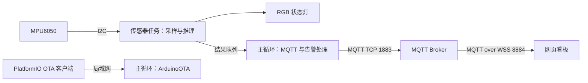

# ESP32-S3 TinyML 手势识别与 MQTT 看板

基于 ESP32-S3、MPU6050 与 Edge Impulse 的设备端手势识别工程。固件采集三轴加速度，在本地识别 `idle`（静止）、`wave`（挥动）和 `shake`（抖动），通过 MQTT 发布分类结果与持续抖动告警，并由浏览器看板展示。

采样与推理由独立 FreeRTOS 任务执行，主循环负责结果消费、MQTT 通信与 ArduinoOTA 服务。Wi-Fi 连接后启用 modem sleep。模型推理不依赖云端服务。

## 演示

33 秒演示：静止（idle）→ 挥手（wave）→ 持续抖动（shake）触发异常告警，网页看板实时同步。

https://github.com/user-attachments/assets/abf948d3-2e76-491e-b87c-b3c3001d1234

## 功能

| 模块 | 功能 |
| --- | --- |
| 数据采集 | MPU6050 三轴加速度采样、校准偏移应用及 m/s² 单位换算 |
| 本地推理 | Edge Impulse 频谱特征提取与三分类推理 |
| 任务通信 | 传感器任务经长度为 4 的 FreeRTOS 队列向主循环传递结果 |
| 状态反馈 | 串口输出分类结果与耗时，WS2812 显示类别灯色 |
| MQTT | 发布分类结果及连续抖动告警，定时尝试恢复 MQTT 连接 |
| OTA | 通过 ArduinoOTA 在局域网内上传固件 |
| 低功耗配置 | Wi-Fi 连接后调用 `WiFi.setSleep(true)` 开启 modem sleep |
| 网页看板 | 显示分类、置信度、告警、原始消息及最近 30 条分类记录 |

## 系统结构



设备与看板通过相同 Broker 和 Topic 通信，可位于不同局域网。OTA 上传要求电脑与设备在可相互访问的局域网中。

## 硬件与接线

当前配置对应 ESP32-S3-WROOM-1 **N16R8** 模块：16 MB Flash、8 MB OPI PSRAM。PlatformIO 板型为 `esp32-s3-devkitc-1`，存储参数由 `platformio.ini` 覆盖。其他板卡须按实际硬件核对存储类型、引脚与 RGB 灯支持。

| MPU6050 | ESP32-S3 | 说明 |
| --- | --- | --- |
| VCC | 3.3V | 按模块规格供电，保持 I2C 电平兼容 |
| GND | GND | 共地 |
| SDA | GPIO8 | I2C 数据线 |
| SCL | GPIO9 | I2C 时钟线 |

MPU6050 使用默认 I2C 地址 `0x68`，总线频率为 400 kHz。RGB 灯为 GPIO48 上的 WS2812。

| 类别 | 含义 | 灯色 |
| --- | --- | --- |
| `idle` | 静止 | 绿色 |
| `wave` | 挥动 | 蓝色 |
| `shake` | 抖动 | 红色 |

`src/main.ino` 中的 `ACCEL_*_OFFSET` 与 `GYRO_*_OFFSET` 对应当前模块的校准结果。更换传感器后需重新校准；校准方法可参考 [MPU6050 上游示例](https://github.com/Mjrovai/XIAO-ESP32S3-Sense/tree/main/IMU/mcu6050-calibration)。

## 环境依赖

- 开发环境：[Cursor](https://cursor.com/) 与 [PlatformIO](https://platformio.org/)。
- PlatformIO 平台：`espressif32 @ 8.0.0`；开发框架：Arduino。
- 本地依赖：`lib/I2Cdev/`、`lib/MPU6050/` 和 `lib/ESP32-S3-TinyML_inferencing/`。
- MQTT 客户端：`knolleary/PubSubClient@^2.8`，由 PlatformIO 安装。
- Wi-Fi 与 OTA：Arduino-ESP32 提供的 `WiFi`、`ArduinoOTA`。
- 网页：现代浏览器，通过 jsDelivr CDN 加载 MQTT.js，无需 npm 构建或应用后端。

Cursor 任务定义位于 `.vscode/tasks.json`。任务及 `.vscode/settings.json` 当前使用本机 PlatformIO 安装路径，其他电脑需调整对应路径，或直接使用 PlatformIO 命令行。

## 配置

### Wi-Fi 凭据

将 [include/secrets.example.h](include/secrets.example.h) 复制为 `include/secrets.h`，填写可用的 **2.4 GHz Wi-Fi**：

```cpp
#pragma once

#define WIFI_SSID "YOUR_WIFI_SSID"
#define WIFI_PASSWORD "YOUR_WIFI_PASSWORD"
```

PlatformIO 自动搜索 `include/`。真实凭据仅保存在 Git 忽略的 `secrets.h` 中，示例文件仅保存占位符。首次克隆后必须创建本地配置才能编译。手动分享目录或固件时，仍需排除真实凭据及包含凭据的构建产物。

### MQTT

以下参数位于 `src/main.ino`：

| 参数 | 默认值 |
| --- | --- |
| Broker | `broker.hivemq.com` |
| 设备端口 | `1883` |
| 分类主题 | `esp32s3-tinyml/aio/gesture` |
| 告警主题 | `esp32s3-tinyml/aio/alert` |

设备与看板的分类主题须一致。看板的告警主题由 `index.html` 中的 `ALERT_TOPIC` 单独配置，修改设备告警主题时须同步修改该常量。公共 Broker 中建议使用设备专属的主题前缀。

## 编译与部署

### Cursor 任务

在 Cursor 打开项目根目录，通过 `Ctrl+Shift+P` → `Tasks: Run Task` 运行以下任务：

| 任务 | 用途 |
| --- | --- |
| `ESP32: Build` | 编译默认环境，也可使用 `Ctrl+Shift+B` |
| `ESP32: List Ports` | 列出可用串口 |
| `ESP32: Upload` | 通过串口编译并烧录，按提示输入串口 |
| `ESP32: Upload (WiFi OTA)` | 通过 Wi-Fi 上传，按提示输入设备 IP |
| `ESP32: Serial Monitor` | 以 115200 波特率打开串口监视器 |

### USB 烧录

在项目根目录执行，`COM7` 为串口示例：

```bash
pio run -e esp32s3
pio device list
pio run -e esp32s3 -t upload --upload-port COM7
pio device monitor -p COM7 -b 115200
```

默认构建环境为 `esp32s3`。构建目录设为 `../.pio-build/onboard-led-blink`，使用项目目录外的 ASCII 路径以兼容 Windows 链接器。

### Wi-Fi OTA

首次部署需通过 USB 烧录当前固件。设备连接 Wi-Fi 后初始化 ArduinoOTA，串口输出设备 IP。后续通过 Cursor 的 Wi-Fi OTA 任务输入该 IP，或使用命令行：

```bash
# 将示例 IP 替换为设备当前的局域网 IP
pio run -e esp32s3_ota -t upload --upload-port 192.168.1.100
```

`esp32s3_ota` 继承 USB 环境的编译配置，上传协议为 `espota`。目标 IP 在上传时指定。当前 OTA 未设置认证，仅应在受信任的局域网内使用；OTA 期间采样与推理的实时性不作保证。

### 网页看板

使用浏览器打开 [index.html](index.html)，或在项目根目录启动本地静态服务：

```bash
python -m http.server 8000 --bind 127.0.0.1
```

访问 `http://127.0.0.1:8000/`。看板默认连接 `wss://broker.hivemq.com:8884/mqtt`，点击“连接”后同时订阅分类与告警主题。设备使用原生 MQTT TCP 端口 1883；浏览器使用 WebSocket TLS 端口 8884。

模拟按钮仅在当前页面生成分类消息，不向 MQTT 发布。清除告警条只隐藏网页提示，不重置设备端告警状态。页面刷新后，记录与告警计数清空。

## 采样与推理

| 参数 | 当前值 |
| --- | --- |
| 输入轴及单位 | `ax`、`ay`、`az`，m/s² |
| 加速度量程 | ±4g，8192 LSB/g |
| 目标采样周期 | 20 ms（50 Hz） |
| 模型输入窗口 | 99 个采样点 × 3 轴，共 297 个数值 |
| 名义窗口时长 | 约 2 秒 |
| DSP | Spectral Analysis |
| 模型输入 / 输出 | INT8 |
| 模型类别顺序 | `idle`、`shake`、`wave` |
| 输出策略 | 选择置信度最高的类别 |

传感器任务使用 `vTaskDelayUntil()` 调度采样，栈空间为 16384 字节，优先级为 2，固定在核心 1。每个输入窗口完成后同步推理、更新 RGB 灯并将结果入队。推理耗时可能导致采样周期超限，当前实现不提供严格的实时采样保证。

主循环处理 MQTT、OTA 与队列结果。队列容量为 4，入队等待时间为 0；队列满时丢弃新结果。网络等待不直接阻塞传感器任务，但可能导致结果丢弃或告警处理延后。

替换模型时须同步核对采样率、输入单位、窗口尺寸、标签顺序，以及 `classify_and_send()` 中结果字段与类别的映射。当前未提供原始训练数据、完整训练配置或独立测试集评估报告。

## 告警规则

主循环根据接收的分类结果进行持续抖动判断：

- 当前标签为 `shake`，且 `p_shake >= 0.80` 时，连续计数递增。
- 连续 3 个达标结果触发一次告警，名义持续时间约为 6 秒。
- 同一连续事件仅触发一次；出现未达标结果后，计数及锁存状态重置。
- MQTT 不可用时告警不缓存，重新连接后不补发本次事件。

规则由 `ALERT_SHAKE_MIN_CONF` 和 `ALERT_CONSECUTIVE` 定义。队列积压与结果丢弃可能影响实际触发时刻。

## MQTT 消息

### 分类结果

主题：`esp32s3-tinyml/aio/gesture`。

```json
{
  "label": "wave",
  "confidence": 0.98,
  "idle": 0.00,
  "shake": 0.02,
  "wave": 0.98
}
```

`confidence` 为选中类别的置信度，三个类别字段均为 0～1 的数值，按两位小数发送。

### 持续抖动告警

主题：`esp32s3-tinyml/aio/alert`。

```json
{
  "type": "alert",
  "event": "shake",
  "confidence": 0.95,
  "count": 3
}
```

`count` 为触发时连续达标的结果数。当前发布使用 QoS 0、非保留消息，无离线缓存或补发。消息不包含设备时间戳；看板显示浏览器接收时间。

## 运行与部署限制

- Wi-Fi 启动连接超时约为 20 秒。未连接时仍启动本地识别，但不启用 OTA；当前未实现显式的 Wi-Fi 重连状态机或恢复后重新初始化 OTA 的流程。
- MQTT 按约 5 秒间隔尝试重连；连接调用本身为同步操作。
- modem sleep 在 Wi-Fi 连接后启用；当前不包含电流或能耗测量结果，也不启用 deep sleep 或 CPU 降频。
- 公共 Broker 无鉴权，设备端 MQTT 为明文通信。正式部署需评估私有 Broker、身份认证、TLS 与 OTA 认证。
- 看板保留当前页面内最近 30 条分类记录，无数据库；超过约 6 秒无分类消息时提示断流，连接关闭后需手动重连。
- 模型仅输出已有三类之一，未设置低置信度拒识或未知类别分支。

## 目录结构

```text
.
├── .vscode/                          # Cursor 编译、烧录与串口任务
├── include/
│   ├── secrets.example.h             # 可公开的 Wi-Fi 配置模板
│   └── secrets.h                     # 本机配置，由 Git 忽略
├── src/
│   └── main.ino                      # 采样、推理、MQTT、告警及 OTA
├── lib/
│   ├── I2Cdev/                       # I2C 驱动依赖
│   ├── MPU6050/                      # 传感器驱动
│   └── ESP32-S3-TinyML_inferencing/   # 模型与推理 SDK
├── model/                            # 模型导出压缩包
├── index.html                        # 网页看板
├── platformio.ini                    # PlatformIO 环境配置
└── README.md
```

本机上游参考仓库 `XIAO-ESP32S3-Sense/` 不参与构建，并由 Git 忽略。参考项目通过下方链接访问。

## 参考与致谢

| 项目 | 参考范围 |
| --- | --- |
| [Mjrovai / XIAO-ESP32S3-Sense](https://github.com/Mjrovai/XIAO-ESP32S3-Sense) | MPU6050 数据采集、校准、模型训练与部署推理 |
| [Nilina2002 / Smart-Helmet-using-ESP32](https://github.com/Nilina2002/Smart-Helmet-using-ESP32) | Wi-Fi、MQTT 上报与网页看板 |
| [Jeff Rowberg / i2cdevlib](https://github.com/jrowberg/i2cdevlib) | I2Cdev 与 MPU6050 驱动 |
| [Edge Impulse](https://www.edgeimpulse.com/) | 模型导出、DSP 与本地推理工具链 |
| [PubSubClient](https://github.com/knolleary/pubsubclient) | 设备端 MQTT 客户端 |
| [MQTT.js](https://github.com/mqttjs/MQTT.js) | 浏览器 MQTT over WebSocket 客户端 |

## 许可证与分发

本项目原创代码与文档采用 [MIT 许可证](LICENSE)，版权署名为 `wht-001`。该许可仅覆盖本项目的原创贡献，不改变复制、修改或依赖的第三方内容的原有授权。第三方代码、模型与资料适用各自的版权及许可要求，参考来源说明不能替代许可证声明。

- XIAO-ESP32S3-Sense 上游采用 [Apache-2.0](https://github.com/Mjrovai/XIAO-ESP32S3-Sense/blob/main/LICENSE)，具体文件的独立声明同时适用。
- I2Cdev 与 MPU6050 源文件包含 MIT 许可声明。
- Edge Impulse SDK 的许可及第三方组件说明见 [SDK LICENSE](lib/ESP32-S3-TinyML_inferencing/src/edge-impulse-sdk/LICENSE)。
- 模型生成文件另有 Edge Impulse 服务条款声明。[model_metadata.h](lib/ESP32-S3-TinyML_inferencing/src/model-parameters/model_metadata.h) 等文件头包含“requires an active paid Edge Impulse subscription”的要求；公开分发模型库和导出包前须核对适用的账户、导出及分发条款。

凭据若曾进入提交历史，仅添加忽略规则不能删除历史内容，应更换已公开的凭据并处理历史记录。
